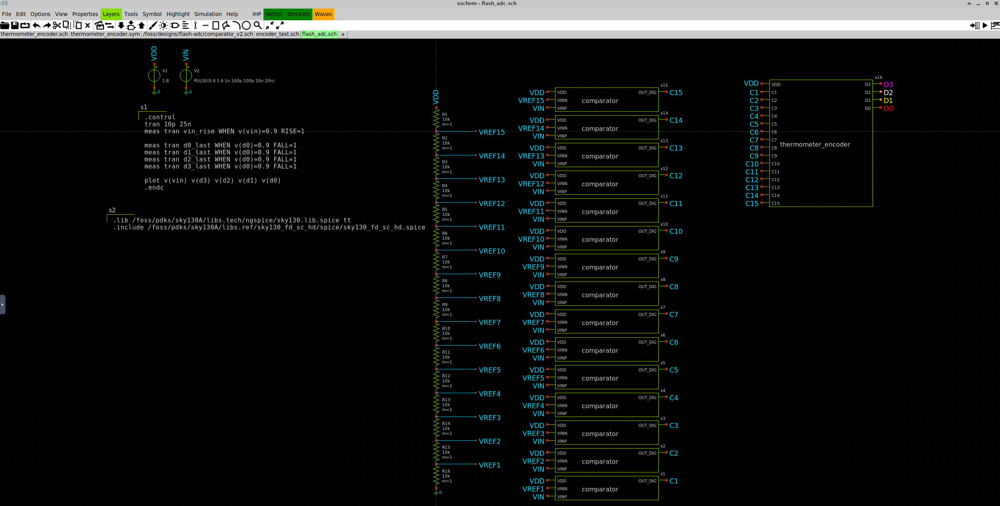
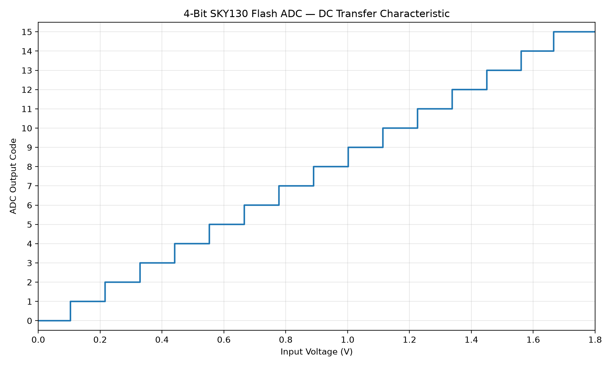
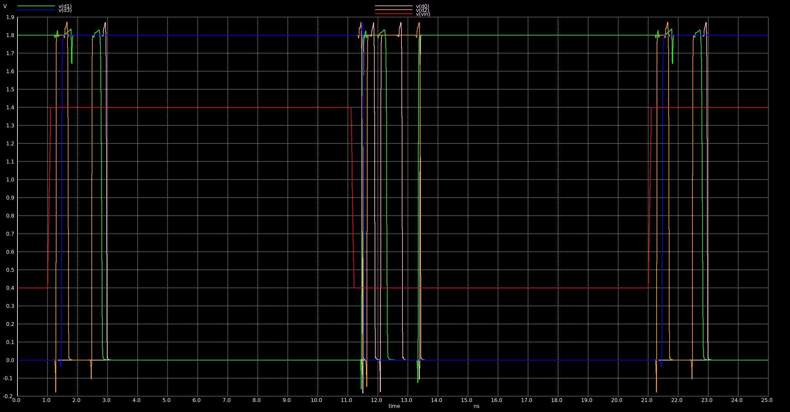

# 4-Bit CMOS Flash ADC — SKY130

## Overview
Designed and simulated a 4-bit flash analog-to-digital converter using the open-source SKY130 CMOS process, Xschem, and NGspice.

The design integrates a resistor reference ladder, 15 transistor-level comparators, and a thermometer-to-binary encoder implemented with standard-cell logic gates.

## Architecture
- **Resolution:** 4 bits (16 output codes)
- **Supply voltage:** 1.8 V
- **Nominal input range:** 0–1.8 V
- **Reference ladder:** 16 × 10 kΩ resistors
- **Comparators:** 15
- **Encoder:** 15-bit thermometer code to 4-bit binary

## Design Schematic

The complete 4-bit flash ADC integrates a resistor reference ladder, 15 CMOS comparators, and a thermometer-to-binary encoder.

## Simulation Waveforms

### DC Transfer Characteristic

The ADC produces 16 monotonic output codes across the nominal 0–1.8 V input range.

### Transient Response

Transient simulation showing the analog input and four digital output signals. Temporary output glitches are visible during switching.

## Simulation Results

| Parameter | Result |
|---|---|
| Ideal LSB | 112.5 mV |
| Maximum absolute DNL | 0.196 LSB |
| Maximum absolute INL | 0.196 LSB |
| Measured input-to-output transition delay | 1.91 ns |
| Supply power at tested operating point | Approximately 0.6 mW |

Results are from nominal simulations. The reported transition delay is not a verified worst-case settling time.

## Tools
- Xschem — schematic capture
- NGspice — transistor-level simulation
- SKY130 PDK — CMOS transistor models and standard cells
- Python — ADC transfer-characteristic analysis

## Verification
- DC sweep to verify ADC code transitions
- DNL and INL calculation using Python
- Operating-point power measurements
- Transient simulation of digital output transitions

## Limitations and Future Work
- Characterize worst-case output settling time and transient glitches
- Evaluate process, voltage, and temperature variation
- Perform layout and post-layout verification
- Investigate comparator input-range limitations and offset sensitivity

## Project Files
- `flash_adc.sch` — integrated ADC
- `comparator.sch` — comparator circuit
- `comparator_v2.sch` — comparator design variant
- `thermometer_encoder.sch` — digital encoder
- `comparator_tb.sch` — comparator testbench
- `encoder_test.sch` — encoder testbench
- `analyze_adc.py` — linearity analysis
- `adc_transfer.txt` — transfer-characteristic data

